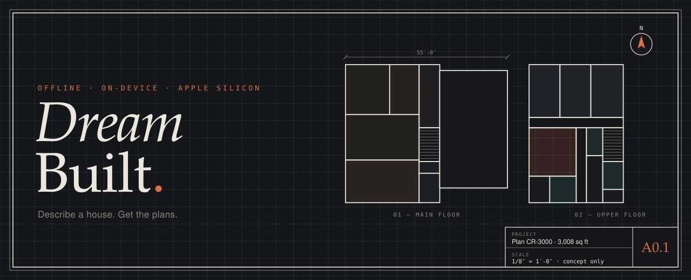
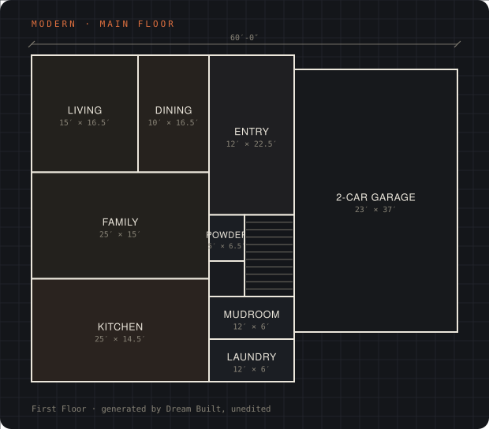
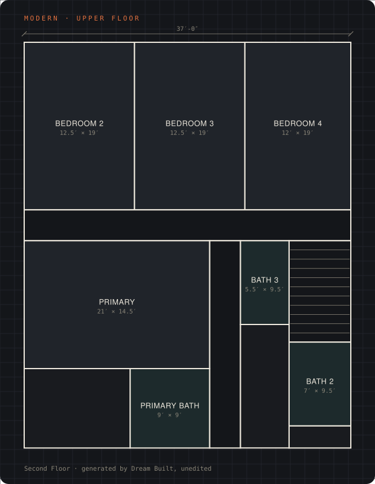
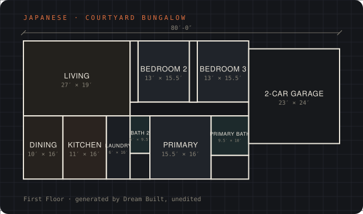
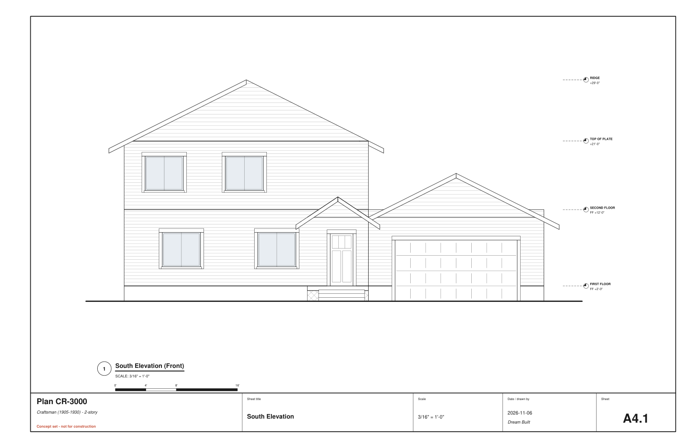

<p align="center">
  
</p>

<p align="center">
  <b>An offline AI house designer for the Mac.</b><br>
  Write the house you want in plain English. Get floor plans, a roof plan, four elevations<br>
  and an 11&times;17 concept set to take to your architect. Nothing leaves your computer.
</p>

<p align="center">
  
  
  
  
</p>

---

### Sheet index

| Sheet | |
|---|---|
| [**A0.1**](#a01--what-it-draws) | What it draws |
| [**A1.1**](#a11--install) | Install |
| [**A2.1**](#a21--write-a-brief) | Write a brief |
| [**A3.1**](#a31--how-it-designs) | How it designs |
| [**A4.1**](#a41--how-good-is-it) | How good is it |
| [**A5.1**](#a51--command-line--python) | Command line &amp; Python |

---

## A0.1 &mdash; What it draws

> *&ldquo;modern 4 bed 3.5 bath 3400 sqft 2 storey 70x140 2 car garage&rdquo;*

<p align="center">
  
  
</p>

Every plan on this page was generated from a one-line brief and is shown unedited.
The upstairs is laid out *on top of* the main floor: baths sit over the kitchen and
laundry, upper walls stand on walls below, the stair is the same rectangle on both floors.

<p align="center">
  
  
</p>

The concept set: cover and brief, site plan, a plan for every floor (basement too),
roof plan and four elevations, in three looks: **modern lines**, **blueprint** and a
**1920s pattern book**. Eleven styles from craftsman to Japanese. Not for construction.

### The app

- Type the house and press Enter. Long, rambling briefs are welcome.
- **Edit by name.** Every room has a fixed title (*Bedroom 3*, *Closet 2*):
  &ldquo;make Bedroom 3 bigger&rdquo;, &ldquo;swap the office and dining&rdquo;, &ldquo;move the kitchen to the back&rdquo;.
- **Drag walls** and **draw on the plan**: circle to select, drag room to room to swap,
  an X to remove.
- **&hearts; and &#10005;** teach it your taste; **Breed** mixes two designs you like.
- Every change is a new version; nothing is ever lost.

---

## A1.1 &mdash; Install

One command. Needs an Apple-silicon Mac (M1 or later), Python 3.10+ and git.

```bash
curl -fsSL https://raw.githubusercontent.com/RyFinance/dreambuilt/main/install.sh | bash
```

It clones the repo into `~/DreamBuilt`, sets up Python, pulls the AI model from
Hugging Face and puts **Dream Built** in `~/Applications`. The app finds the model by
itself, so there's nothing to configure. Run the same command again to update.

<details>
<summary>Or step by step</summary>

```bash
git clone https://github.com/RyFinance/dreambuilt ~/DreamBuilt && cd ~/DreamBuilt
python3 -m venv .venv && .venv/bin/pip install -e ".[app,llm]"
.venv/bin/dreambuilt get-model                 # MiniCPM5-2B, about 1.4 GB, once
.venv/bin/python tools/make_app.py --install   # "Dream Built" in ~/Applications
```
</details>

| Part | Size |
|---|---|
| App and engine | under 1 MB of Python |
| Python environment (Qt, MLX) | about 750 MB |
| [MiniCPM5-2B](https://huggingface.co/openbmb/MiniCPM5-2B-MLX) (Apache-2.0, 4-bit) | about 1.4 GB |

The model is optional. Without it a rule-based reader handles the brief, and the designs
are exactly the same: the model only helps with chatty wording
(&ldquo;eleven hundred square feet&rdquo;, &ldquo;my bedroom on the ground floor so I don&rsquo;t
climb stairs&rdquo;) and with free-form edit requests.

---

## A2.1 &mdash; Write a brief

Plain English works. These are the words it acts on:

| You say | It does |
|---|---|
| `2 storey`, `bungalow`, `one level`, `3 storeys` | storeys (a bungalow stays one storey) |
| `4 bed 3.5 bath`, `4 bedrooms and 3 and a half baths` | rooms; `.5` is a powder room |
| `3,200 sq ft`, `3.2k`, `4,200 sq ft above ground` | size (above ground: the basement comes on top) |
| `60x130 lot`, `20 x 80`, `a 50 foot lot`, `7,000 sq ft lot` | lot |
| `craftsman`, `colonial`, `foursquare`, `mid-century`, `west coast` / `Surrey`, `modern`, `modern farmhouse`, `mediterranean` / `spanish`, `tudor`, `scandinavian` | style |
| `big kitchen`, `small office`, `huge primary suite`, `spa ensuite`, `big walk-in` | that room's size |
| `kitchen at the back`, `office at the front`, `dining near the front` | where a room goes |
| `primary on the main floor`, `primary upstairs` | primary floor |
| `3 car garage`, `double garage`, `garage built in`, `no garage` | garage (built into the house; bedrooms or the primary go over it when the house needs the room) |
| `basement`, `small basement 600 sq ft`, `basement with a theatre, gym and wine room`, `1 bed rental suite` | basement and what's in it |
| `townhouse`, `row house`, `infill` | townhouse: garage and den below, living on 2, bedrooms on 3 |
| `family room`, `office` / `den`, `mudroom`, `pantry`, `fireplace`, `porch`, `upstairs laundry` | rooms and features |
| `grand entrance`, `two-storey foyer`, `double doors`, `vaulted`, `open plan`, `dormers`, `symmetrical` | character |
| `stone`, `brick`, `board and batten`, `stucco`, `cedar`, `flat roof`, `hip roof`, `big windows` | outside |
| `Small things: oak floors, black frames, warm lighting` | kept as notes on the drawings |
| `no basement`, `not a fan of flat roofs`, `don't want a garage` | the opposite |

Custom rules stick to a design too: *ensuite bathrooms only*, *front door in the middle*,
*open floor plan*, *no bathrooms in a row*, *office near the entry*.

---

## A3.1 &mdash; How it designs

No neural network draws the plan. The language model only reads your words; the house
is designed by a rules engine that searches.

1. **Read** the brief: rules first (every number, room, place and size word); the local
   model fills only the gaps.
2. **Program**: rooms and target areas from beds, baths, size and your size words.
3. **Generate**: dozens of candidates per brief, each a different set of decisions
   (core position, room order, what goes over the garage, plan shape). The upper floor is
   searched separately over hundreds of arrangements that fit the main floor below it.
4. **Check**: every room reached properly, no pass-through bedrooms, no twin or rowed
   bathrooms, the primary clearly the biggest, plumbing stacked, walls over walls, plus an
   informal 2021 IRC pre-check (room sizes, egress, stairs, light).
5. **Choose**: feasibility first, then what you asked for, then design quality, then
   variety, so the three options you see really differ.
6. **Draw**: windows evened and aligned floor to floor, porches with an even column count
   and the door clear, ridges that meet, roofs and cladding per style.

Room shapes and neighbours are scored against statistics from 4,299 real floor plans
(CubiCasa5K, aggregate numbers only).

---

## A4.1 &mdash; How good is it

`tools/quality.py` counts what an architect would mark on a plan: hard rule failures,
missing rooms, bathrooms in a row or with no plumbing below, narrow or cramped rooms,
long halls, closet waste, dark rooms, walls that don't stack, a primary that isn't clearly
the best room, and room pairings real plans almost never have.

| Engine | Tuning briefs (24) | Held-out briefs (15) |
|---|---|---|
| First version | 5.83 flaws / house | 5.53 |
| **This release** | **2.79** | **3.47** |
| This release + real-plan library | 2.79 | 2.73 |

Held-out briefs were never looked at while tuning. The real-plan library (one-storey plans
traced from CubiCasa5K) can be built locally with `tools/fetch_cubicasa_svgs.py` and
`tools/build_plan_library.py` but isn't redistributed here; the first-version numbers
were measured with it.

```bash
.venv/bin/python tools/quality.py
```

---

## A5.1 &mdash; Command line &amp; Python

```bash
.venv/bin/dreambuilt render --text "2 storey colonial 4 bed 2.5 bath 2400 sqft 70x140 office" -o out/
.venv/bin/dreambuilt design --text "tudor 5 bed 4.5 bath 4200 sqft 75x140 3 car garage" --options 3
.venv/bin/dreambuilt check  --text "3 storey townhouse 3 bed 2.5 bath 20x80 with a garage"
.venv/bin/dreambuilt render examples/briefs/craftsman-bungalow.yaml --all-styles -o out/
```

`--llm` reads the text with the local model; `--save-model house.json` keeps the design
for hand edits.

```python
from dreambuilt.brief import parse_text
from dreambuilt.design import design
import dreambuilt

house = design(parse_text("modern farmhouse 4 bed 3 bath 3200 sqft 80x140 2 car garage"))
dreambuilt.render_pdf(house, "farmhouse.pdf", style="modern")
```

The art on this page is drawn from live designs: `.venv/bin/python tools/readme_art.py`.

---

<sub>MIT licensed. Concept drawings only, not for construction. MiniCPM5-2B by OpenBMB
(Apache-2.0) is downloaded separately. Floor-plan statistics are aggregates derived from
CubiCasa5K (Kalervo et al. 2019, CC BY-NC-SA 4.0); the dataset itself is not included.</sub>
